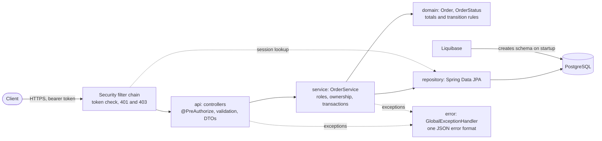
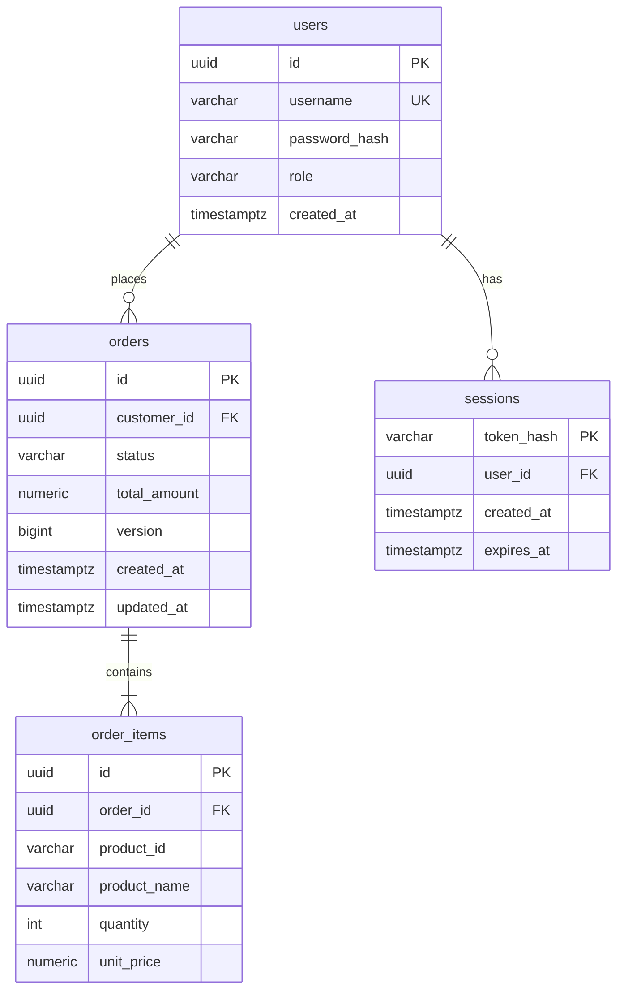
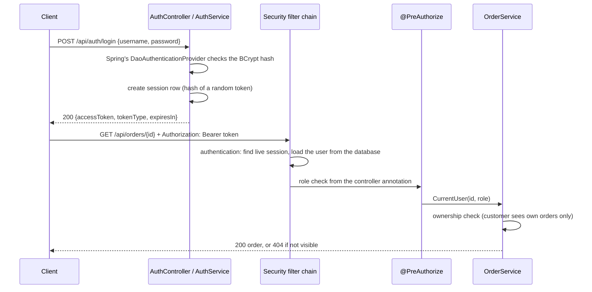

# Order Management API - Design Document

Status: complete. The packaging, Compose and CI setup is in section 11.

## 1. Understanding of the requirements

A small REST API, built with Java 17 and Spring Boot, for creating and managing orders.

- Three roles: `CUSTOMER`, `SUPPORT`, `ADMIN`.
- An order has one or more items. The server calculates the total.
- Status lifecycle: `CREATED -> CONFIRMED -> SHIPPED -> DELIVERED`.
- Persistence in PostgreSQL, with Liquibase migrations.
- Authentication and authorization are separate concerns. Identity and role are never taken from the request body.
- Deliverables: source code, unit and integration tests, Dockerfile, Docker Compose, GitLab CI pipeline, README, this document.

Priorities (from section 9): working core API, correct business rules and persistence, meaningful security, tests for critical behavior, documentation, basic CI/CD.

## 2. Clarifying questions and assumptions

The brief leaves some things open and allows reasonable assumptions as long as they are documented. These are the ones I made.

### Authentication and identity
- Users log in with `POST /api/auth/login`. The credentials are checked against a `users` table that stores BCrypt password hashes. A successful login starts a **server-side session** stored in the database and returns a random session token.
- Every other request must send that token as `Authorization: Bearer <token>`. Spring Security looks the session up in the database on each request and builds the user (ID, role) from the current `users` row. This keeps authentication (who you are) apart from authorization (what you may do).
- `POST /api/auth/logout` deletes the session, so the token stops working at once.
- The user ID and role always come from the database for the session, never from the request body or from anything the client can edit.
- There is no signing secret to manage: the token is a random value that carries no data, and only its SHA-256 hash is stored.
- Sample users exist only in the `dev` and `test` setups, with obviously fake passwords. Production has none, so the dev setup can't be mistaken for real authentication.
- There is no separate customer entity. An order's customer ID is simply the logged-in user's ID.

### Money and order data
- Prices and totals use `BigDecimal` in Java and `NUMERIC` in PostgreSQL (`NUMERIC(10,2)` for unit prices, `NUMERIC(15,2)` for order totals, sized for the largest valid order of 100 items x quantity 1000 x 99,999,999.99), because `double` can't represent decimal amounts exactly. One currency is assumed. Prices with more than 2 decimal places are rejected rather than rounded, so line totals and order totals are always exact.
- The client sends `unitPrice` (as in the brief's example) because there is no product catalog. It is validated, and the total is always calculated on the server. A client-supplied total is ignored. A real system would look prices up in a catalog, so this is listed as a limitation.
- Input limits protect the service: at most 100 items per order, quantity 1 to 1000, unit price 0.01 to 99,999,999.99.
- The same product may appear on several lines. Each line is stored as sent.

### Roles and access
- **CUSTOMER** can create orders and read only their own.
- **SUPPORT** can read any order and update its status, but cannot create orders.
- **ADMIN** can do everything SUPPORT can, create orders (assigned to the admin's own ID), and delete orders. Delete is a hard delete.
- A customer who requests someone else's order gets `404`, not `403`, so order IDs can't be probed. Role-based denials, such as a customer calling the status endpoint, still return `403`.

### Status transitions
- Only forward and one step at a time: `CREATED -> CONFIRMED -> SHIPPED -> DELIVERED`. No skipping, no going back, no cancellation.
- SUPPORT and ADMIN may perform all three transitions. CUSTOMER may perform none. ADMIN does not bypass the transition rules.
- An invalid transition returns `409 Conflict`, because the request is valid but doesn't fit the order's current state.
- Concurrent updates are handled with optimistic locking (a `version` column). A losing update also returns `409`.

### API conventions
- Paths are lowercase: `/api/orders`.
- All errors use one application-defined JSON body (an `ErrorResponse` DTO, content type `application/json`), produced by a single `@RestControllerAdvice`. Every error case, including 401 and 403 from Spring Security, returns the same shape:
  - `status`: the HTTP status code.
  - `error`: a stable machine-readable code such as `VALIDATION_FAILED`, `ORDER_NOT_FOUND` or `INVALID_STATUS_TRANSITION`. Clients branch on this, not on the message.
  - `message`: a short human-readable explanation that never contains internal details.
  - `timestamp`: when the error occurred (UTC, ISO-8601).
  - `path`: the request path.
  - `fieldErrors`: optional list of `{field, message}` for validation failures. Omitted otherwise.
- Why a custom DTO instead of RFC 7807 Problem Details (`application/problem+json`)? It is a plain class that the team fully controls and can extend easily, and there is no dependency on a particular RFC or on Spring's `ProblemDetail` type. Both options work with a global exception handler, so the choice is about simplicity and maintainability. The trade-off is that the format is not a standard, so it must be documented for API consumers (see section 5), and framework exceptions such as malformed JSON or unsupported methods must be mapped explicitly in the handler.
- Paging uses `page` (starting at 0), `size` and `sort`. The default size is 20, the maximum is 100 (larger values are capped), and the default sort is `createdAt,desc`.
- Sorting is limited to `createdAt`, `updatedAt`, `status` and `totalAmount`. Any other field returns `400`.

### Testing and operations
- Integration tests use Testcontainers with the same PostgreSQL version as production, not H2, to avoid dialect differences. This means Docker must be running.
- The tests are layered. Unit tests (no Spring) cover totals, validation and transitions. Service tests cover business and ownership rules against the real database. MockMvc API tests send real HTTP requests through the real security filter chain, with real session tokens, and check both the responses and the rows in the database. One workflow test uses only the public API and real logins. Every test creates its own users and orders, so tests do not depend on each other or on their order.
- The integration requirements map to tests as follows: create and retrieve (`OrderApiTest`, `OrderWorkflowTest`), persistence of orders and items (`OrderApiTest`, `DatabaseSchemaTests`), a customer's own orders and denial of another's (`OrderApiTest`, `OrderServiceTest`), role restrictions on status updates and delete (`OrderApiTest`, `SecurityTest`), invalid input and missing orders (`OrderApiTest`, `ErrorHandlingTest`), and a missing token (`SecurityTest`).
- The Actuator `health` endpoint is exposed for Docker Compose and deployment checks. Other actuator endpoints are disabled.

### API documentation
- The API is documented with OpenAPI 3, generated from the code by `springdoc-openapi`. Swagger UI is served at `/swagger-ui.html` and the raw spec at `/v3/api-docs`.
- Controllers and DTOs carry annotations (`@Operation`, `@ApiResponse`, `@Schema`) so that each endpoint lists its request and response bodies, the `ErrorResponse` shape and the possible status codes (400, 401, 403, 404, 409).
- Bearer authentication is declared as a security scheme, so a reviewer can log in through `POST /api/auth/login`, paste the token into the Swagger UI "Authorize" dialog, and try the endpoints. Each operation also lists its allowed roles in its summary.
- Swagger UI and `/v3/api-docs` are enabled in the `dev` and `test` setups only. They are disabled by default in production, because they reveal the full API surface.
- Generating the docs from code keeps them in sync with the implementation. The curated examples in section 5 and in the README remain the human-readable overview.

### Deliberately left out
- Idempotent order creation. Out of scope for a time-boxed assignment, noted as a future improvement.
  - **What it is:** an operation is idempotent if repeating the same request has the same effect as sending it once. `GET`, `PUT` and `DELETE` are idempotent by definition. `POST /api/orders` is not: sending it twice creates two orders.
  - **Why it matters:** a client that times out or loses its connection can't tell whether the order was created, so it retries. Without protection this produces duplicate orders, and a customer could be charged or shipped twice.
  - **How it would work:** the client sends a unique `Idempotency-Key` header (for example a UUID) with each create request. The server stores the key with the resulting order. If the same key arrives again, the server returns the original response instead of creating a new order. A key reused with a different body is rejected.
  - **What it would need:** a table or column with a unique constraint on (user ID, key), plus a retention period for old keys.

## 3. Role and permission matrix

| Operation | Description | Endpoint | Method | CUSTOMER | SUPPORT | ADMIN | Anonymous |
|-----------|-------------|----------|--------|----------|---------|-------|-----------|
| login | Exchange credentials for a session token | `/api/auth/login` | POST | yes | yes | yes | yes |
| logout | End the session of the token used for the call | `/api/auth/logout` | POST | yes | yes | yes | 401 |
| createOrder | Create an order for the logged-in user | `/api/orders` | POST | yes (own) | no (403) | yes (own) | 401 |
| getOrder | Retrieve one order by ID | `/api/orders/{id}` | GET | own only (else 404) | any | any | 401 |
| getMyOrders | Paged list of the caller's own orders | `/api/orders/my` | GET | yes | yes | yes | 401 |
| getAllOrders | Paged list of all orders | `/api/orders` | GET | no (403) | yes | yes | 401 |
| updateOrderStatus | Move an order to its next status | `/api/orders/{id}/status` | PATCH | no (403) | yes | yes | 401 |
| deleteOrder | Permanently delete an order | `/api/orders/{id}` | DELETE | no (403) | no (403) | yes | 401 |
| health | Liveness and readiness check | `/actuator/health` | GET | yes | yes | yes | yes |
| apiDocs | OpenAPI spec and Swagger UI (dev and test only) | `/v3/api-docs`, `/swagger-ui.html` | GET | yes | yes | yes | yes (dev/test), 404 in prod |

Orders are always assigned to the authenticated user. Creating orders on behalf of another customer is out of scope. SUPPORT cannot create orders.

### Status transitions

| From | To | Allowed roles |
|------|----|---------------|
| CREATED | CONFIRMED | SUPPORT, ADMIN |
| CONFIRMED | SHIPPED | SUPPORT, ADMIN |
| SHIPPED | DELIVERED | SUPPORT, ADMIN |
| any other combination | - | rejected with 409 |

## 4. Architecture

A layered Spring Boot application, packaged by layer under `com.example.orders`. A request flows top to bottom, and each layer only calls the one below it.

| Package | Responsibility |
|---------|----------------|
| `api` | REST controllers and request/response DTOs. Maps HTTP to service calls. No business logic and no entities in responses. |
| `service` | Business rules: role and ownership checks, creating orders, status changes, transaction boundaries. Returns immutable `OrderView` objects. |
| `domain` | JPA entities (`Order`, `OrderItem`, `User`, `LoginSession`), the `OrderStatus` and `Role` enums, the transition rules, and domain exceptions such as `InvalidStatusTransitionException`. |
| `repository` | Spring Data JPA repositories. |
| `security` | `CurrentUser` (the caller as the service sees it), sessions (`SessionStore`, `SessionTokenIntrospector`), the Spring Security user (`AppUser`, `AppUserDetailsService`), the filter chain and method security (`SecurityConfig`), and the 401 and 403 handlers. |
| `config` | The `Clock` bean (replaceable in tests) and the OpenAPI metadata, including the bearer-token security scheme. |
| `error` | `ErrorResponse` DTO, application exceptions (`OrderNotFoundException`, `InvalidRequestException`), and the global `@RestControllerAdvice`, which also maps the domain exceptions to HTTP responses. |



Why layers: the application is small, the responsibilities are easy to name, and each layer can be tested on its own (domain and service logic with plain unit tests, the API with integration tests).

### Domain model
- **`OrderStatus`** is an enum that knows its single valid next status (`next()`) and answers `canTransitionTo(target)`. It only describes the lifecycle. Which role may request a transition is an authorization rule, enforced in the security and service layers, so the enum stays free of user and role concepts.
- **`Order`** is created only through `Order.create(customerId, items, now)`. The factory sets the status to `CREATED`, assigns the owner, and calculates `totalAmount` from the items. There is no way to pass a total in. Status changes go through `changeStatus(target, now)`, which throws `InvalidStatusTransitionException` for anything but the next status and leaves the order untouched. It also updates `updatedAt`. Items are exposed as an unmodifiable list.
- **`OrderItem`** validates itself on construction (quantity 1 to 1000, unit price 0.01 to 99,999,999.99 with at most 2 decimals, non-blank product ID and name). `lineTotal()` is unit price times quantity.
- The domain checks these rules a second time, even though the API validates the request first. This keeps invalid orders impossible however the entities are created. The API turns bad input into a `400` response before the domain is reached.
- Time is passed in as an `Instant` parameter instead of read inside the entities, which keeps the unit tests deterministic.
- The entities are never returned from the API. Controllers use separate DTOs (section 5).
- Entities use `@Version` for optimistic locking and `@Enumerated(STRING)` for the status. Hibernate validates these mappings against the Liquibase schema on every startup.

### Technology baseline
- Java 17, Spring Boot 3.5, Maven (wrapper included, run with `./mvnw`).
- Spring Web, Spring Data JPA (Hibernate), Bean Validation, Spring Security (bearer-token support for the session tokens, method security with `@PreAuthorize`).
- PostgreSQL with Liquibase migrations. Hibernate only validates the schema (`ddl-auto: validate`), Liquibase owns it.
- `springdoc-openapi` for the API docs, Actuator for the health endpoint.
- JUnit 5, Spring Security Test and Testcontainers (PostgreSQL 16) for tests.

### Configuration
- Configuration comes from environment variables (`DB_URL`, `DB_USERNAME`, `DB_PASSWORD`). The base `application.yml` has no defaults for them, so the application fails to start if they are missing.
- Profiles: `dev` provides fake local defaults and enables Swagger UI. `test` is used by the automated tests. A production run supplies real values through the environment and enables neither.
- Each profile also selects a Liquibase context (`dev`, `test`, `prod`), which controls whether the fake seed users are created (see section 6).
- Local database (and optionally the application, see section 11): `docker/docker-compose.yml` starts PostgreSQL 16 on `127.0.0.1:5432` with a named volume. Its credentials come from `docker/.env` (copied from the committed `docker/.env.example`, which holds fake local-only values). The `dev` profile defaults match those values, so no extra setup is needed to run the app locally.
- `open-in-view` is off, so database access stays inside the service layer. Error stack traces and messages are never included in Spring's default error output.

## 5. API design

All endpoints except login and health need `Authorization: Bearer <token>`. Who may call what is in the matrix in section 3. The generated OpenAPI spec and Swagger UI (see "API documentation" in section 2) list every status code. The samples below use the example from the brief.

### Create an order: `POST /api/orders`
Request (there is no customer, status or total field; extra fields such as `totalAmount` are ignored):
```json
{
  "items": [
    {"productId": "PROD-101", "productName": "Keyboard", "quantity": 2, "unitPrice": 49.99},
    {"productId": "PROD-102", "productName": "Mouse", "quantity": 1, "unitPrice": 19.99}
  ]
}
```
Response `201 Created`, with `Location: /api/orders/{id}`:
```json
{
  "id": "5b0a3c1e-8f0e-4a43-9d58-0c8e6d2f7a11",
  "customerId": "11111111-1111-1111-1111-111111111111",
  "status": "CREATED",
  "totalAmount": 119.97,
  "createdAt": "2026-11-05T09:30:00.123456Z",
  "updatedAt": "2026-11-05T09:30:00.123456Z",
  "items": [
    {"productId": "PROD-101", "productName": "Keyboard", "quantity": 2, "unitPrice": 49.99, "lineTotal": 99.98},
    {"productId": "PROD-102", "productName": "Mouse", "quantity": 1, "unitPrice": 19.99, "lineTotal": 19.99}
  ]
}
```
Validation (rejected with `400`): at least 1 and at most 100 items; `productId` and `productName` not blank (at most 50 and 200 characters); `quantity` 1 to 1000; `unitPrice` 0.01 to 99,999,999.99 with at most 2 decimals.

### Read orders
- `GET /api/orders/{id}` returns one order (same shape as above). A customer asking for someone else's order gets `404`, exactly like for an ID that does not exist.
- `GET /api/orders/my` returns the caller's own orders.
- `GET /api/orders` returns all orders (SUPPORT, ADMIN).

Both list endpoints return a page:
```json
{"content": [ /* orders as above */ ], "page": 0, "size": 20, "totalElements": 42, "totalPages": 3}
```
Query parameters: `page` (from 0), `size` (default 20, capped at 100), `sort` as `field,direction`, for example `?sort=totalAmount,asc&size=50`. The default is `createdAt,desc`. Allowed fields: `createdAt`, `updatedAt`, `status`, `totalAmount`. The ID is always added as the last sort key so pages do not overlap when values are equal.

### Update status: `PATCH /api/orders/{id}/status`
Request `{"status": "CONFIRMED"}`, response `200` with the updated order. Only the next status is accepted (see section 3). Anything else returns `409`.

### Delete: `DELETE /api/orders/{id}`
ADMIN only. Response `204` with no body.

### Design notes
- **Separate DTOs.** Controllers use request and response records in `api`. The service returns an immutable `OrderView` that is built inside the transaction, so no lazy-loading or entity state reaches the controller (`open-in-view` is off).
- **Identity.** Controllers receive the authenticated `AppUser` and convert it to a `CurrentUser` (ID and role). Both come from the `users` row that the session belongs to.
- **Where rules live.** The service enforces roles and ownership for every operation, so the rules hold for any caller. The controllers repeat the role rules with `@PreAuthorize` (section 7), as a first line of defence that rejects the request before the service runs.
- **Transactions.** Each service method is one transaction. Reads are `readOnly`. A status change loads the order, applies the domain rule and commits, and the `version` column turns a concurrent change into a conflict instead of a lost update.
- **Paging.** Items of a page of orders are loaded with one batched query (`default_batch_fetch_size`), not one query per order.

## 6. Data model

The schema is owned by Liquibase (`backend/src/main/resources/db/changelog`). Hibernate only validates it.



### Constraints
- Every column is `NOT NULL`. IDs are UUIDs generated by the application.
- `users`: unique `username`, `role` limited to `CUSTOMER`, `SUPPORT`, `ADMIN`.
- `orders`: `customer_id` references `users`, `status` limited to the four statuses, `total_amount > 0`. `version` is the optimistic locking column. Indexed on `customer_id` (the "my orders" query) and `created_at` (default sort).
- `order_items`: `order_id` references `orders` with `ON DELETE CASCADE`, so deleting an order removes its items. `quantity` between 1 and 1000, `unit_price > 0`. Indexed on `order_id`.
- `sessions`: the SHA-256 hash of each session token (the token itself is never stored), the user, and when it expires. `user_id` references `users` with `ON DELETE CASCADE`, so deleting a user ends their sessions. Indexed on `user_id` and `expires_at`. It is mapped by the `LoginSession` entity and accessed through `SessionRepository` (Spring Data JPA), like the other tables. Expired rows are deleted on later logins.
- The JPA entities (`Order`, `OrderItem`, `User`, `LoginSession`) map to these tables. Hibernate runs with `ddl-auto: validate`, so a mismatch between entity and schema stops the application at startup, and the startup test catches it. `Order.items` cascades all operations and removes orphans, which matches the `ON DELETE CASCADE` foreign key.
- The API validates the same rules first and returns a clear `400`. The database constraints are a safety net, so invalid data can't be stored even if a bug bypasses validation.

### Migrations
- Migrations are written in Liquibase XML. `db.changelog-master.xml` includes one file per change in `changes/`, in order. Each table has its own changeset (`001` to `003`, and `005` for sessions) with an explicit rollback. Columns and keys use Liquibase's native XML elements (`createTable`, `addForeignKeyConstraint`, `createIndex`). The `CHECK` constraints use a plain `<sql>` element, because Liquibase has no XML element for them.
- `004-seed-dev-users` creates four fake users (`customer1`, `customer2`, `support1`, `admin1`, password `dev-password-1`). It runs only in the `dev` and `test` Liquibase contexts. The base config sets the context to `prod`, because Liquibase runs every changeset when no context is set.
- Data survives restarts: locally, Postgres stores data in a named Docker volume (`docker compose down` keeps it, `down -v` deletes it).

## 7. Authentication and authorization

> **Not production-ready authentication.** This is a deliberately small, self-contained setup for the assignment. It has no external identity provider, no password policy or account lockout, and no rate limiting. The `dev` and `test` setups contain fake users with a publicly documented password. Section 10 lists what a real deployment would add.

Authentication (who are you) and authorization (what may you do) are separate steps. The approach is **server-side session authentication**: the client holds a random session token, and the server holds the session.



### Authentication
- **Login:** `POST /api/auth/login` is checked by Spring Security's `DaoAuthenticationProvider` with our `UserDetailsService` (`AppUserDetailsService`, backed by the `users` table) and a `BCryptPasswordEncoder`. An unknown username and a wrong password produce the same `401`, and the provider spends the same time on both, so response time does not reveal which usernames exist.
- **Session token:** 256 bits from `SecureRandom`, Base64URL encoded (43 characters). It contains no information. The database stores only its SHA-256 hash (table `sessions`), so a leaked database or backup does not contain usable tokens.
- **Lifetime:** a session expires a fixed time after login (default 30 minutes, `app.security.session.expiration-minutes`). It is not extended by use.
- **Every request:** Spring's bearer-token support passes the token to `SessionTokenIntrospector`. It hashes the token, looks up an unexpired session, and loads the user from the `users` table (`AppUser`, with the role as the authority `ROLE_<role>`). If there is no live session or the user is gone, the request gets `401`. Because the user is loaded each time, a role change or a deleted user takes effect on the next request.
- **Identity:** the user ID and role come only from the database row of the session's user (`CurrentUser`). Nothing from the request body or headers is trusted as identity.
- **No HTTP session, no cookies:** the filter chain is stateless. "Session" here means our `sessions` table, not the servlet session.
- **CSRF protection is switched off on purpose.** CSRF attacks rely on the browser sending credentials automatically (cookies). Here the token is sent explicitly in the `Authorization` header, so there is nothing to forge. This would need to be revisited if the token were ever stored in a cookie.
- **Logout:** `POST /api/auth/logout` (any logged-in user) deletes the session of the token used. From then on that token gets `401`, including a second logout. Other sessions of the same user stay valid, so logging out on one device does not end the others.

### Authorization
There are three layers, because some rules can be decided from the request alone and others need the data:

1. **Filter chain** (`SecurityConfig`): login, health and the API docs are public. Everything else needs a live session.
2. **Roles on the controller methods** (`@PreAuthorize`, enabled with `@EnableMethodSecurity`). The matrix in section 3 is declared next to each endpoint, for example `@PreAuthorize("hasRole('ADMIN')")` on delete. The controller class defaults to `isAuthenticated()`. A denied role gets `403`.
3. **Service layer** (`OrderService`): repeats the role rules, so they still hold if a new controller or job calls the service. It also does the ownership check, which needs the loaded order: a customer asking for an order that is not theirs gets the same `404` as for an ID that does not exist. This cannot be a `@PreAuthorize` rule, because that would answer `403` and reveal that the order exists.

`AppUser` is the principal, so expressions such as `principal.id` are available to `@PreAuthorize` if a rule needs the caller's ID.

Public endpoints: `POST /api/auth/login`, `GET /actuator/health`, and the OpenAPI spec and Swagger UI (which exist only in `dev` and `test`).

**Order of checks.** The controller method is only entered after request parsing and validation, so a caller with the wrong role who also sends an invalid body or a malformed ID gets `400`, not `403`. The `401` for a missing or invalid token always comes first, and no data is returned or changed in either case.

### Error responses from the security layer
`401` and `403` use the same `ErrorResponse` JSON as all other errors (section 8). The `401` response carries `WWW-Authenticate: Bearer` and the same generic message for a missing, malformed, unknown, expired or logged-out token, so it gives an attacker no hints. The `403` response says only that the operation is not permitted.

### Known limitations
- Every authenticated request reads the `sessions` and `users` tables (two indexed primary-key lookups). That is fine at this scale, and it is the price of instant logout and instant role changes. A larger system would cache the lookup or use short-lived signed tokens.
- A session is bound to one database. Several application instances work, because they share the database, but the database is then part of every request's critical path.
- There is no "log out everywhere" or admin endpoint to end another user's sessions, no refresh or sliding expiry, and no brute-force protection on the login endpoint (no rate limiting or lockout).
- Passwords are limited to 72 bytes, the input limit of BCrypt.

## 8. Error handling and transaction boundaries

### One error shape
Every error response, whoever produces it, has the `ErrorResponse` JSON body:

```json
{"status": 404, "error": "ORDER_NOT_FOUND", "message": "Order not found.",
 "timestamp": "2026-11-05T09:30:00.123456Z", "path": "/api/orders/5b0a3c1e-..."}
```

- `error` is a stable code for clients to branch on. `message` is for people.
- `fieldErrors` (a list of `{field, message}`) is present only for `VALIDATION_FAILED` and is omitted otherwise.
- `timestamp` comes from the injected `Clock`. `path` is the request path.

### Who produces it
- **`GlobalExceptionHandler`** (`@RestControllerAdvice` in `error`) handles everything that reaches the controllers. It extends Spring's `ResponseEntityExceptionHandler`, so Spring's own web exceptions (wrong method, wrong media type, unknown path, missing parameter) get the same shape.
- **The security layer** (`RestAuthenticationEntryPoint`, `RestAccessDeniedHandler`) handles `401` and `403` raised in the filter chain, before any controller. It uses `ErrorResponseWriter` to write the same body. Controllers and services can also throw `AccessDeniedException` (for example the role checks in `OrderService`). The advice maps those to the same `403`, and without that mapping the catch-all would turn them into a `500`.

### Mapping

| Situation | Status | `error` code |
|-----------|--------|--------------|
| Bean Validation failure on the body | 400 | `VALIDATION_FAILED` (with `fieldErrors`) |
| Malformed JSON, wrong field type, unknown enum value, missing body | 400 | `MALFORMED_REQUEST` |
| Bad path or query value (such as a non-UUID ID), disallowed sort field, other bad requests | 400 | `INVALID_REQUEST` |
| No valid token, or wrong username or password | 401 | `UNAUTHORIZED` |
| Role not allowed | 403 | `FORBIDDEN` |
| Order missing, or belonging to someone else | 404 | `ORDER_NOT_FOUND` |
| Unknown path | 404 | `NOT_FOUND` |
| Method not supported (with `Allow` header) | 405 | `METHOD_NOT_ALLOWED` |
| Media type not supported | 415 | `UNSUPPORTED_MEDIA_TYPE` |
| Status change not allowed from the current status | 409 | `INVALID_STATUS_TRANSITION` |
| Two people changed the same order at once (optimistic lock) | 409 | `CONCURRENT_MODIFICATION` |
| Anything else | 500 | `INTERNAL_ERROR` |

### Not leaking internals
- Messages are written in the handler, not copied from exceptions. The exceptions are the ones written for clients: the invalid-transition message (it only names two statuses) and the sort-field message.
- A `404` for a missing order and for another customer's order is identical, so IDs cannot be probed.
- Malformed JSON never shows the parser message, which can include class names. Validation errors name the field and the rule only.
- The catch-all returns a generic `500` message. The full exception with its stack trace is logged on the server only.
- Spring Boot's fallback `/error` page is configured to hide stack traces, messages and binding errors, in case an error happens outside the advice.

### Invalid status transitions: 409, not 422
`409 Conflict` was chosen because the request is well formed but conflicts with the current state of the order. The same code is used for a lost update, which is the same kind of problem: the order is not in the state the client assumed.

### Transaction boundaries
Each `OrderService` method is one transaction, and reads are `readOnly`. Login and logout are not wrapped in a long transaction, because BCrypt is slow on purpose. An exception thrown inside a service method rolls the transaction back, so a rejected status change or a failed create leaves no partial data. Exceptions are turned into HTTP responses after that, in the advice, outside the transaction. The `version` column makes a concurrent change fail with `CONCURRENT_MODIFICATION` instead of silently overwriting it.

## 9. Design decisions and trade-offs

| Decision | Why | Trade-off |
|----------|-----|-----------|
| Money as `BigDecimal` and `NUMERIC(12,2)`, totals calculated on the server | No rounding errors, and a client cannot send a wrong total | Unit prices still come from the client (no product catalog) |
| Database-backed session token instead of JWT | A token can be revoked at once (logout), nothing sensitive sits in the token, and only its SHA-256 hash is stored. It is also simple to explain | One database lookup per request, and no single sign-on. A real system would use an identity provider |
| `@PreAuthorize` on controllers and role checks again in the service | The service stays safe if it is called from somewhere else, and the controller rejects early | The rules exist in two places, kept in sync by tests |
| Another customer's order gives `404`, not `403` | Does not reveal that an order ID exists | A client cannot tell "not yours" from "missing" (intended) |
| Invalid status change gives `409` | The request is valid but conflicts with the current state, same as a lost update | Some teams prefer `422` |
| Only the next status is allowed, one linear lifecycle | Simple, predictable and easy to test | No cancellation or going back |
| Liquibase owns the schema, Hibernate only validates | Reviewable, repeatable migrations, and a mapping mistake fails at startup | Each schema change needs a changeset |
| Optimistic locking with `@Version` | Concurrent status changes cannot overwrite each other, without holding locks | The loser gets `409` and must retry |
| Layered packages, separate DTOs, immutable `OrderView` | Clear responsibilities, nothing lazy leaks out of the transaction | A few more classes than a minimal version |
| One `ErrorResponse` format with stable error codes, generic `500` | Easy for clients, and no internals leak | Detail for debugging is only in the logs |
| Testcontainers with real PostgreSQL instead of H2 | Tests run against the same engine, constraints and types as production | Docker is needed to run the tests, and they are slower |
| Paging with a capped size and an allow-list of sort fields | Protects the database and prevents sorting by arbitrary columns | Sorting is limited to four fields |
| Compose runs the app with the `dev` profile | The demo works in one command, with sample users | Must never be used for a real deployment. The comment in the Compose file says so |

## 10. Known limitations and future improvements

Limitations:
- Unit prices and product names are supplied by the client. There is no product catalog, stock or price check.
- No idempotency: a repeated create request (for example after a timeout) creates a second order.
- No cancellation, no returns, no payment, and the status path is fixed.
- The login is a simple local one. There is no registration, password change, account lockout or rate limiting, and the sample users exist in dev and test only. Session tokens are looked up in the database on every request.
- Expired sessions are rejected and removed only when someone logs in, so on a system without logins they stay in the table.
- Totals use a single currency that is not stored.

Possible improvements, in the order I would do them:
1. Replace the login with an external identity provider (OpenID Connect) and validate signed tokens, keeping `@PreAuthorize` and the service checks.
2. Add rate limiting and lockout on login, and a scheduled job that deletes expired sessions.
3. Add an `Idempotency-Key` header for order creation.
4. Add a product catalog so prices are read on the server, and store a currency.
5. Add cancellation as a status with its own rules, and an order history table for audit.
6. Add metrics and tracing, and structured (JSON) logs with a request ID.

## 11. CI/CD and deployment

### Implemented
- **Container image:** `backend/Dockerfile` has a build stage (JDK, Maven wrapper, dependencies cached in their own layer) and a runtime stage (JRE only, non-root user, health check, container-aware memory settings).
- **Docker Compose:** `docker/docker-compose.yml` runs PostgreSQL and the application. The application waits for the database health check, gets its database settings from environment variables, runs with a read-only file system, no Linux capabilities and `no-new-privileges`, and both ports are bound to localhost. PostgreSQL alone can be started with `up -d postgres`.
- **GitLab CI (`.gitlab-ci.yml`):** `compile`, `test` and `package` jobs. The Maven repository is cached, JUnit reports are published, and the jar is kept as an artifact. The `test` job uses a Docker-in-Docker service for Testcontainers.

### What I would add (not implemented)
The pipeline would continue after `package` with these stages. Each stage runs only if the previous one passed, and deployment only from the main branch.
1. **Build and publish the image.** Build with the Dockerfile (Kaniko or Docker-in-Docker), tag it with the commit SHA (and a version tag for releases), and push it to the GitLab container registry. Deploy by tag, never `latest`, so a rollback means redeploying an older tag.
2. **Scan.** Dependency scanning (for example OWASP Dependency-Check or GitLab Dependency Scanning), image scanning (Trivy) and secret detection.
3. **Environment-specific configuration and secrets.** The same image runs everywhere. The environment supplies `DB_URL`, `DB_USERNAME` and `DB_PASSWORD`, with no profile set, so there are no sample users and no API docs. Secrets are stored in the GitLab CI/CD variables (masked and protected) or in a secret manager that the platform injects at start. They never go into the repository, the image or the logs. Each environment has its own database and credentials.
4. **Safe database migrations.** Liquibase runs on application start, which is fine for one instance. With several instances, run it as a separate step before the rollout (a Kubernetes job or a pipeline job), because Liquibase uses a lock and only one runs at a time. Migrations must be backwards compatible with the version that is still running (add columns before using them, drop them one release later, the "expand and contract" pattern), so a rollback of the application does not need a database rollback. Take a backup before production migrations.
5. **Deploy to a test environment.** Deploy the tagged image automatically on every merge to main (for example with Helm or a Compose file on a test server), and a production deployment behind a manual approval.
6. **Health check and rollback.** After a deployment, the pipeline calls `/actuator/health` until it reports `UP` or a timeout passes, then runs a few smoke requests (login, create order). The platform's readiness probe keeps traffic away from instances that are not ready. If the check fails, the pipeline redeploys the previous image tag, and a rolling or blue-green rollout keeps the old version running until the new one is healthy.
7. **Operations.** Logs and metrics go to a central system, with alerts on the error rate and on the health check.
